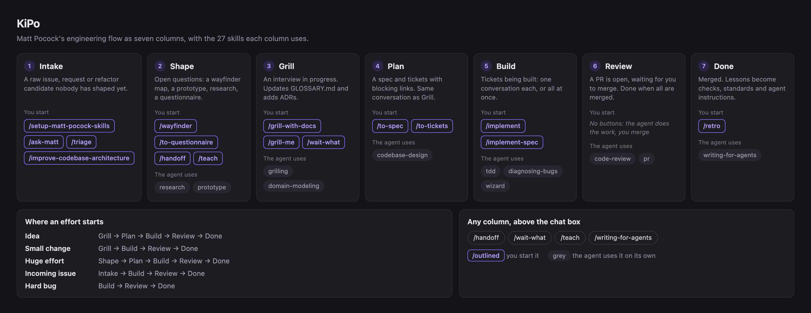

# KiPo

A Kiro Crew app that runs Matt Pocock's engineering skills over your repos. Each effort's
tickets are tiles in two lanes, Decide and Deliver, read from GitHub; the next step sits on
top, and each ticket has its own conversation running the right skills. Open wayfinder maps
can be put on the sidebar as efforts. See CONTRACT.md.

Forked from Launchpad (same plumbing, a different model).



## Install

You need:

- [Kiro Crew](https://kiro.dev/crew) 0.13.0 or later, signed in to Kiro
- The GitHub CLI, signed in: `gh auth login`
- Matt Pocock's skills, installed globally: `npx skills add mattpocock/skills -g`
  KiPo reads them from `~/.agents/skills`. If yours live elsewhere, set `KIPO_SKILLS_DIR`.

Then:

```bash
kirocrew app install https://github.com/<owner>/kipo.git --ref main
```

The app installs disabled. Open the Crew dashboard, review its permissions, enable it,
and KiPo appears in the sidebar. Add a repo from KiPo's page to start an effort.

## Update

Pull the latest from the App Store page in the dashboard, or:

```bash
curl -X POST http://localhost:5476/api/apps/kipo/update
```

## Developing

The built UI bundle (`ui/dist/index.mjs`) is committed so installs don't need a build.
After changing `ui/src`, rebuild it (`cd ui && npm install && npm run build`), bump
`version` in `app.json`, and commit both. Backend tests: `cd backend/tests && python3 -m unittest`.
